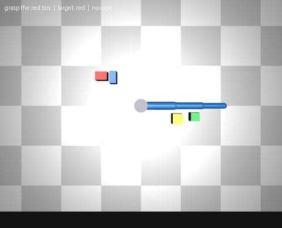
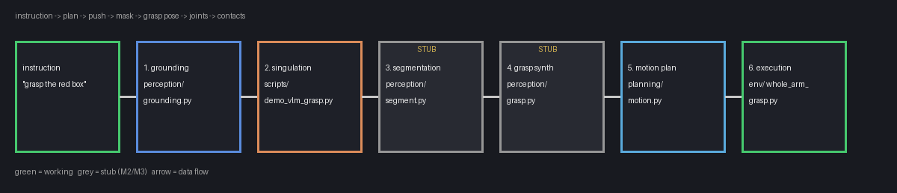
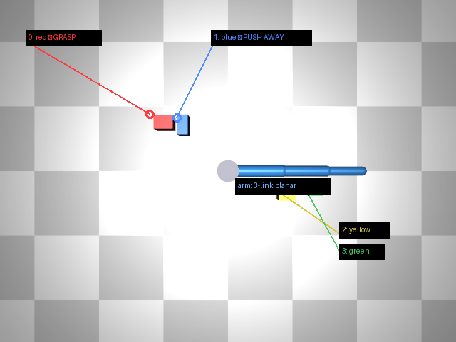
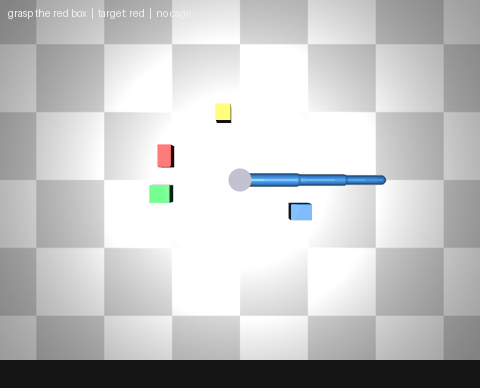

# Language-Conditioned Grasping in Simulation

A robot arm that understands instructions like *"grasp the red box, first push
the blue box away"* — and does it in simulation. The VLM handles language
(which object? what to push?), classical robotics handles geometry (where it
is, how to move). No hardware, no fine-tuning; the point is the integration.


*Seed 7: the arm shoves the blue box away from the red box (isolation
0.106 → 0.159 m), then moves in to grasp.*

> This is the **non-thesis** version: a general VLM foundation-model demo and
> portfolio piece (not the 2014 thesis redo). The VLM backend is swappable —
> local open models (Qwen-VL/LLaVA) for the portfolio, or Nemotron via Nebius
> Token Factory if targeting the Nebius hackathon.

## How the code is set up

```
grasping-2026/
├── env/                    # the world: MuJoCo sim + reward + metrics
│   ├── arm.xml             #   3-link planar arm, top-down camera, table
│   └── whole_arm_grasp.py  #   env: reset/step/render, contact reward,
│                           #   isolation metric, snapshot/restore
├── perception/             # the VLM front end (semantics)
│   ├── grounding.py        #   goal + image -> {grasp_target, push_away}
│                           #   (preconditions for "grasp in isolation")
│   ├── segment.py          #   STUB (M2): detection -> pixel mask
│   └── grasp.py            #   STUB (M3): mask -> ranked grasps
├── planning/               # geometry: IK + action primitives
│   ├── motion.py           #   joint-space trajectory interpolation
│   └── primitives.py       #   Cartesian action space:
│                           #   move_tip(x, y), push(x, y, theta, dist),
│                           #   envelop(x, y) — the whole-arm grasp skill
├── scripts/
│   ├── demo_vlm_grasp.py   #   the main loop: goal -> preconditions ->
│                           #   singulation (push primitives) -> isolation
│                           #   gate -> envelop skill
│   ├── smoke_vlm.py        #   live VLM check (needs NEBIUS_API_KEY)
│   ├── verify_pipeline.py  #   exercises every stage, saves screenshots
│   └── make_video.py       #   episode frames -> captioned GIF
├── tests/
│   └── test_pipeline.py    #   13 tests, all runnable headless in CI
├── docs/
│   ├── img/                #   diagrams, labeled scenes, demo GIFs
│   └── vlm-grounding-tutorial.md   # deep dive on the grounding stage
├── episodes/               # logged runs (frames.npz + meta.json)
└── Dockerfile              # headless container (MUJOCO_GL=osmesa)
```

The split is deliberate: `perception/` answers *what/which* (language),
`planning/` answers *where/how* (geometry — IK + Cartesian primitives),
`env/` is the physics, `scripts/` wires them together. The VLM never
outputs raw coordinates (it's bad at metric estimation); it outputs
semantic preconditions, and a resolver turns those into `push()` calls.
The enveloping grasp is a named skill, not a `(x, y, theta)` tuple —
wrapping 3 links around an object is a trajectory, not a pose.

## Follow one instruction through the code

Instruction: `"grasp the red box in isolation"` (seed 7). The task is framed
as a goal with preconditions: the VLM decides *what must happen first*, the
isolation metric decides *whether it happened*, and only then does the grasp
start.



**0. The scene.** `env.reset(seed=7)` spawns 4 boxes. `env.objects` is the
source of truth: `[{index: 0, color: 'red', ...}, ...]`.


*What the top-down camera sees. Red crowds blue (0.106 m apart) — that's why
singulation matters here.*

**1. Grounding** (`perception/grounding.py`). `labeller.plan(image, objects,
instruction)` reasons about preconditions and returns:

```python
{"grasp_target": 0, "push_away": [1], "rationale": "..."}
```

The VLM (`NebiusVLMLabeller`) gets the image + the object list as text and
replies with JSON; the offline fallback (`HeuristicLabeller`) parses
"push the \<color\>" / "grasp the \<color\>" with regexes. Indices are
validated — an out-of-range index raises instead of guessing. Full worked
example in `docs/vlm-grounding-tutorial.md`.

**2. Singulation** (`scripts/demo_vlm_grasp.py: scripted_singulate`). Executes
the preconditions using the Cartesian `push()` primitive
(`planning/primitives.py`): for each object in `push_away`, compute the push
direction (away from the target), start at the object's target-facing edge,
and `push(start_xy, theta, dist)` — the tip approaches via IK, then tracks
a straight Cartesian line while contact forces shove the box. Each push is
tried optimistically and **reverted** (physics snapshot + dropped frames) if
isolation drops, the target moves more than the distractor, or anything
launches. Tracked by the `isolation` metric (`env.target_isolation()`): min
distance from the grasp target to any other object.

**Isolation gate.** After the pushes, the demo checks
`isolation >= 0.15 m`. Only if the preconditions are met does the grasp
start; otherwise it's logged (`preconditions_met: false`) and the grasp is
attempted anyway as a fallback.

**3–4. Segmentation / grasp synthesis** (`perception/segment.py`,
`perception/grasp.py`). STUBs — interfaces fixed, SAM wiring (M2) and the
antipodal sampler (M3) are next.

**5–6. Motion + execution** (`planning/motion.py`, `env/`). The scripted
placeholder yaws at the target, reaches, and curls the links around it. The
goal metric is **caging**: ≥2 distinct arm links in contact with the target
(one link is a poke; two is an enveloping grasp). Checked every physics step
in `env._reward()` from raw MuJoCo contacts; reward = `0.5 × links + 2.0`
on cage.

## Quickstart (Docker only)

No local Python setup needed — everything runs in the container.

```bash
# 1. (Optional) live VLM grounding: copy the template and add your key.
#    Without it, the demo uses an offline color-matching fallback.
cp .env.example .env   # then edit .env

# 2. Run the demo. Episodes land in ./episodes/.
docker compose run --build --rm demo --instruction "grasp the red box in isolation" --seed 7
```

Expected output:

```
[demo] plan: grasp object 0 (red), push away [] — heuristic: grasp 'red'
[singulate] pushed obj1 (blue): iso 0.216 m
[demo] singulation: isolation 0.106 -> 0.216 m
[demo] preconditions met (isolation 0.216 m >= 0.15 m) — starting grasp
[demo] links touching: 0, caged: False, total reward: 2.5
[demo] episode saved to episodes/20261023_112926
```

Episodes land in `episodes/<stamp>/` (`frames.npz` + `meta.json`). Without
`NEBIUS_API_KEY` in `.env`, grounding uses the offline fallback; with a key
and model set, it runs through a Nemotron vision model on Nebius Token
Factory instead.

Verify everything works (also via container):

```bash
docker compose run --build --rm demo --instruction "grasp the red box in isolation" --seed 7
```

To run the test suite locally you still need a Python env (see
Contributing below), but the demo itself is container-only.

## Container details

`docker-compose.yml` defines the `demo` service: builds the image from
`Dockerfile`, mounts `./episodes` for output, and passes `NEBIUS_*` variables
from `.env` (compose auto-loads `.env` for interpolation — a missing file
just means empty values, i.e. offline fallback). Extra demo flags pass
through after the service name:

```bash
docker compose run --build --rm demo --instruction "grasp the blue box" --seed 1 --frame-every 1
```

Headless rendering is via `MUJOCO_GL=osmesa` (set in the image and the
compose file); no GPU or display needed. The SAM checkpoint (M2) is mounted
at runtime with an extra `-v`, never baked into the image. Secrets go via
`.env`, never into the image. The prebuilt image (`ghcr.io/arii/grasping-2026`,
published by CI on main) can replace `build: .` in the compose file if you
don't want to build locally.

## Running the demo

```bash
# VLM planning (default; falls back to heuristic if the VLM fails)
docker compose run --build --rm demo --instruction "grasp the red box in isolation" --seed 7
# Scripted planning only — no VLM call, no cost
docker compose run --build --rm demo --instruction "grasp the red box in isolation" --seed 7 --planner heuristic
```

## Comparing planners (VLM vs scripted)

`scripts/compare_planners.py` runs the same pipeline (plan → singulate →
gate → cage) with each planner on each seed and reports the goal
criterion (force closure rate) plus diagnostics and VLM cost. VLM mode
here is pure — no fallback — so a VLM failure counts as a VLM failure.

```bash
docker compose run --build --rm --entrypoint python demo scripts/compare_planners.py --seeds 0-9
docker compose run --build --rm --entrypoint python demo scripts/compare_planners.py --seeds 0,5,7 --planners heuristic --out /tmp/cmp.json
# With GIFs: per-seed episodes/compare-<seed>/ gets vlm.gif, heuristic.gif,
# and side_by_side.gif (both halves, labeled, outcome captions; the
# shorter half holds its final pose while the other keeps moving)
docker compose run --build --rm --entrypoint python demo scripts/compare_planners.py --seeds 0-9 --gifs
```

## VLM call ledger (audit + cache)

Every VLM call is logged to `episodes/vlm_ledger.jsonl` (JSONL, one entry
per line) — input, prompt, raw response, parsed plan, and token usage.
Identical calls (same model, instruction, and scene) reuse the cached plan
instead of calling the API again, so rerunning the same seed costs nothing.

Each entry: `timestamp`, `model`, `instruction`, `objects`, `image_sha256`
(scene fingerprint), `prompt`, `response`, `plan`, `usage` (tokens),
`cache_hit`, `cache_key`. Cache hits still append an entry, so the ledger
shows every `plan()` invocation, API call or not.

- Default location: `episodes/vlm_ledger.jsonl` (inside the episodes volume,
  so it persists across container runs).
- Override: `NEBIUS_LEDGER_PATH` (e.g. a different path, or empty to disable).

## Visualizer

Every demo run writes `episodes/<stamp>/demo.gif` automatically (caption
bar with instruction, target color, and whether it caged). No separate
step needed — use `--no-gif` to skip it, `--gif-fps` to change the rate.

For old episodes (saved before built-in GIFs), `scripts/make_video.py`
still works standalone:

```bash
docker compose run --build --rm --entrypoint python demo scripts/make_video.py episodes/<stamp>/ --out episodes/demo.gif --fps 10
```

Each GIF gets a caption bar with the instruction, target color, and whether
the episode caged the object. `--frame-every 1` keeps full-rate frames for
smooth video; the default `4` keeps episode files small.


*The scripted cage on an uncrowded seed: yaw, reach, curl — 2 links in
contact = caged.*

### Pinned working versions
Recorded 2026-10-22 from a green dependency resolution
(`pip install ".[rl]"` dry-run; base image `python:3.11-slim`):

| Dep | Version | Notes |
|---|---|---|
| mujoco | 3.16.0 | sim backend; needs `mjGEOM_BOX` enum name (not the removed `mjtGEOM_BOX` alias) |
| numpy | 2.5.4 | |
| pillow | 13.0.0 | |
| requests | 2.34.2 | VLM API client |
| gymnasium | 1.4.0 | `[rl]` extra; satisfies SB3's `gymnasium<2.0` |
| stable-baselines3 | 2.9.0 | `[rl]` extra |
| torch | 2.14.1 | via SB3 (CPU wheel in container) |
| setuptools | 84.2.1 | build backend |

System packages (both stages): `libglfw3`, `libgl1`, `libosmesa6`;
builder adds `build-essential`. (Note: this VM wipes apt packages on
restart — reinstall if `import mujoco` fails with an OSMesa error.)

## What's next

1. Wire SAM into `perception/segment.py` (checkpoint + predictor).
2. Implement antipodal sampling in `perception/grasp.py`.
3. Generalize the sim backend from the planar arm to a 3D tabletop
   arm+gripper (`env/` is the v1 backend; interfaces above don't care).
4. RL baseline (`scripts/train_rl_baseline.py`) for the learned-vs-classical
   comparison — and a learned singulation policy (the scripted push helps
   ~13% of crowded scenes; a policy should do much better).
5. Demo video + public repo (needs: Nemotron wiring, LICENSE ✅ done).

## Contributing (local dev)

The demo is container-only, but tests and development use a local env:

```bash
pip install -e ".[test]"
MUJOCO_GL=osmesa pytest -v          # 13 tests, headless
MUJOCO_GL=osmesa python scripts/verify_pipeline.py --seed 7   # stage-by-stage + screenshots
```

System packages needed for headless rendering: `libglfw3`, `libgl1`,
`libosmesa6` (Debian/Ubuntu: `sudo apt-get install -y libosmesa6 libglfw3 libgl1`).

## Blog post

Draft: `../goals/learn-llm-driven-grasping-tutorial/files/language-conditioned-grasping-blog-draft.md`
(in the grasping goal's files — placement TBD: arii.github.io vs BoomTick).

## Tutorials

- `docs/vlm-grounding-tutorial.md` — the grounding stage worked end to end:
  prompt, request shape, plan parsing (`grasp_target` + `push_away`),
  failure modes, and how to verify it (mock tests in CI +
  `scripts/smoke_vlm.py` against the live model).
